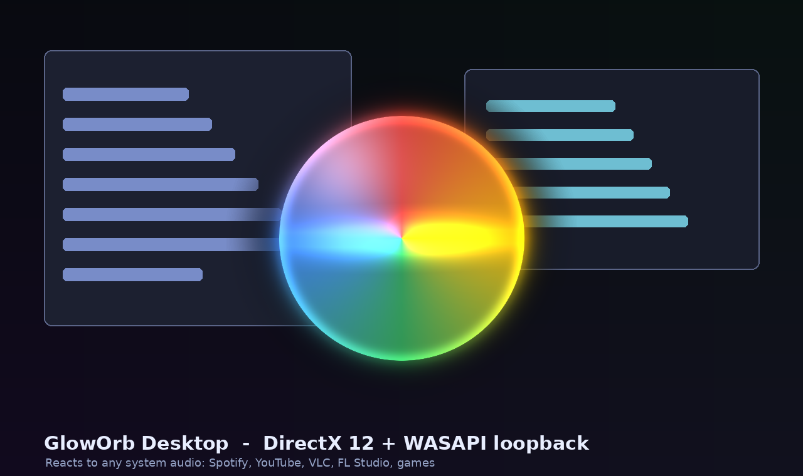

# GlowOrb Desktop

A **native Windows desktop audio visualizer** built with **C++17 + DirectX 12 + WASAPI loopback**.
It captures the *system audio mix* — so it reacts to anything playing on your computer:
Spotify, YouTube, Chrome, VLC, FL Studio, Discord, games, or plain system sounds.
No browser, no per-app plugin, no virtual cable, no mic.

The visuals are a faithful port of the WebGL orb in
[`amazingcreationsltd/glow-orb`](https://github.com/amazingcreationsltd/glow-orb):
the same silk-sheet fragment shader, the same state presets, the same 24 color
gradients, the rotating conic halos, and the same audio-hit stardust particles —
now running as a transparent, click-through, always-on-top Win32 overlay.



---

## 1. What you get

| Feature | Detail |
| --- | --- |
| **System-wide capture** | `IAudioClient` in `AUDCLNT_STREAMFLAGS_LOOPBACK` shared mode on the default render endpoint. |
| **Auto device switching** | `IMMNotificationClient` reopens the stream when you change the default output or unplug a device. Optionally pin a specific endpoint from the tray menu. |
| **Audio analysis** | 1024-point Hann FFT, spectral-flux beat detection, bass/mid/treble bands, smoothed RMS level, 256-tap live waveform texture. |
| **Render** | DX12 flip-model swapchain, premultiplied alpha, DirectComposition visual, fullscreen-triangle pixel shader, additive instanced particles, 3 frames in flight. |
| **Window** | `WS_EX_LAYERED + WS_EX_NOREDIRECTIONBITMAP + WS_EX_TRANSPARENT + WS_EX_TOPMOST + WS_EX_TOOLWINDOW + WS_EX_NOACTIVATE`. Per-pixel transparent, mouse clicks pass through, never steals focus. |
| **Opaque fallback** | If DirectComposition is unavailable, it automatically falls back to a normal opaque borderless window (or force it with `--opaque`). |
| **Tray UI** | Presets, audio device, position, monitor, visual state, size, gain, particles, click-through, always-on-top, screen-capture exclusion, pause, settings, exit. |
| **Settings window** | Live sliders + combos, saved to `%APPDATA%\GlowOrb\settings.ini`. |
| **Hotkey** | `Ctrl+Alt+P` → next color preset. |
| **Zero third-party deps** | Only the Windows 10/11 SDK. No vcpkg, no NuGet, no d3dx12.h, no WRL, no JSON library. HLSL is compiled at runtime from `shaders\Orb.hlsl` via `D3DCompileFromFile`. |

---

## 2. Requirements

* Windows 10 (2004+) or Windows 11 — **x64**
* A DirectX 12 capable GPU + driver (feature level 11.0 is enough)
* Visual Studio 2022 with **Desktop development with C++** (includes the Windows 11 SDK)
* CMake 3.20+ (or use `build_cl.bat` to skip CMake entirely)
* `D3DCompiler_47.dll` — ships with Windows 10/11 and with the Windows SDK

---

## 3. Build

### Option A — CMake + Visual Studio (recommended)

```bat
build.bat
```

Output: `build\Release\GlowOrb.exe`, with `shaders\` and `assets\` copied beside it.
Open `build\GlowOrbDesktop.sln` in VS2022 to debug.

### Option B — plain `cl.exe` (no CMake)

From an **x64 Native Tools Command Prompt for VS**:

```bat
build_cl.bat
```

Output: `out\GlowOrb.exe`, `out\shaders\`, `out\assets\`.

### Option C — cross-compile from Linux / WSL (MinGW-w64)

```bash
cmake -S . -B build-mingw -DCMAKE_TOOLCHAIN_FILE=cmake/toolchain-mingw.cmake
cmake --build build-mingw -j1
```

This is exactly how this project was validated during development (all 14 TUs
compiled and linked against real `d3d12.h` / `mmdeviceapi.h` / `dcomp.h`, and all
four HLSL entry points were parsed with `glslangValidator`).
A MinGW build also needs `libgcc_s_seh-1.dll` and `libstdc++-6.dll` unless you
add `-static-libgcc -static-libstdc++` (already set in `CMakeLists.txt`).

---

## 4. Run

Double-click `GlowOrb.exe`. Play any audio. The orb appears at the position in your
settings (center by default) and starts reacting. **Right-click the tray icon** for
everything.

```
GlowOrb.exe --opaque            # normal opaque window instead of transparent overlay
GlowOrb.exe --no-clickthrough   # draggable window
GlowOrb.exe --size 720          # window / orb size in px (200..1400)
GlowOrb.exe --gain 5            # input gain (0.5..12)
GlowOrb.exe --preset 2          # Apple Siri palette
GlowOrb.exe --position 1        # bottom center
GlowOrb.exe --monitor 1         # second display
```

Settings persist in `%APPDATA%\GlowOrb\settings.ini`; logs in
`%APPDATA%\GlowOrb\gloworb.log`. Delete the INI to reset.

---

## 5. Data flow

```
   ANY APP (Spotify, Chrome, VLC, FL Studio, game, ...)
                │  Windows audio engine renders the shared mix
                ▼
   ┌──────────────────────────────────────────────────────────────┐
   │ AudioCapture  (own MTA thread, timer-driven WASAPI loopback)    │
   │  IMMDeviceEnumerator → default eRender/eConsole                 │
   │  IAudioClient::Initialize(SHARED | LOOPBACK, 100 ms buffer)     │
   │  IAudioCaptureClient::GetBuffer → float32/int16/24/32 → mono    │
   │  IMMNotificationClient → reinit on default-device change        │
   └───────────────────────────┬──────────────────────────────────┘
                               ▼  lock-free-ish SPSC ring buffer
   ┌──────────────────────────────────────────────────────────────┐
   │ AudioAnalyzer (render thread)                                 │
   │  RMS → uLevel  •  1024-FFT → bass/mid/treble + beat            │
   │  256 samples → R8_UNORM uWaveTex                              │
   └───────────────────────────┬──────────────────────────────────┘
                               ▼  OrbConstants (512-byte root CBV)
   ┌──────────────────────────────────────────────────────────────┐
   │ D3D12Renderer                                                 │
   │  CreateSwapChainForComposition + DXGI_ALPHA_MODE_PREMULTIPLIED  │
   │  IDCompositionVisual::SetContent(swapchain)                    │
   │  Pass 1: fullscreen triangle → PSOrb (ported GLSL)             │
   │  Pass 2: instanced quads, ONE/ONE blend → PSParticles           │
   │  Present(1, 0) → DWM composites over your desktop              │
   └──────────────────────────────────────────────────────────────┘
```

---

## 6. How the WebGL demo maps to DX12

| Web (`index.html` / `script.js` / `styles.css`) | Native |
| --- | --- |
| `<canvas id="orb">` + `getContext('webgl')` | Layered Win32 popup + DX12 flip-model composition swapchain |
| `gl_FragCoord` + `VERT`/`FRAG` GLSL | `SV_Position` + `VSFullscreen`/`PSOrb` in `shaders/Orb.hlsl` (Y flipped) |
| `uniform1f/3f(...)` | `OrbConstants` root constant buffer (`b0`) |
| `uWaveTex` `LUMINANCE` 256×1 bytes | `Texture2D` `R8_UNORM` 256×1, uploaded with `CopyTextureRegion` per frame (`t0`) |
| `analyser.getByteTimeDomainData()` | WASAPI loopback ring buffer → `AudioAnalyzer` waveform |
| `analyser` FFT 512 / `getByteFrequencyData` | 1024-point radix-2 FFT, Hann window, 3 bands + spectral flux |
| `STATE_TABLE` (idle/listening/thinking/speaking) | `App::ParamSet` lerped at `dt*6`, auto-selected from RMS level |
| `buildPalette()` + 24 `.preset` buttons | `Palette.cpp` + `Presets.cpp` (same hex colors and hue rotation) |
| CSS `conic-gradient` `haloOuter`/`haloInner` | `conicHalo()` in HLSL, rotating with `uHaloAngle`, 5 halo stops |
| 2D `binaryOrbits` canvas particles | `ParticleSystem.cpp` → `StructuredBuffer` (`t1`) → additive instanced quads |
| `canvas.style.transform = scale(...)` | `uParams5.x` orb scale in the vertex math inside `PSOrb` |
| mic / file upload | removed — replaced by system-wide loopback |
| sliders / buttons in the HTML panel | tray menu + modeless Win32 settings window |

Two intentional differences:

1. The native shader outputs **premultiplied alpha** (required by
   `DXGI_ALPHA_MODE_PREMULTIPLIED`). The original already emitted `rgb <= alpha`,
   so the look is preserved.
2. The native window leaves extra room around the orb so the halo can breathe
   (`uSize = 0.74 * windowSize`, halo fades at `r = 1.34` instead of `0.998`).

---

## 7. Files

```
glow-orb-desktop/
├── CMakeLists.txt                  MSVC / MinGW build
├── build.bat                       one-click VS2022 build
├── build_cl.bat                    one-click cl.exe build (no CMake)
├── cmake/toolchain-mingw.cmake     cross-compile from Linux
├── shaders/Orb.hlsl                4 entry points: VSFullscreen, PSOrb,
│                                   VSParticles, PSParticles
├── assets/gloworb.ico              tray + taskbar icon
├── assets/preview.png              README concept illustration
├── tools/make_assets.py            regenerate icon + preview (Pillow/NumPy)
├── tools/check_hlsl.sh             optional glslang HLSL syntax check
└── src/
    ├── main.cpp                    wWinMain
    ├── App.h/.cpp                  frame loop, state machine, uniform packing
    ├── Common.h                    Win32/COM/DX12 includes, ComPtr, HR macros
    ├── Util.h/.cpp                 paths, logging, monitors, DPI
    ├── Settings.h/.cpp             INI persistence
    ├── Presets.h/.cpp              24 palettes + halo gradients
    ├── Palette.h/.cpp              buildPalette() port
    ├── RingBuffer.h                capture → analyzer SPSC buffer
    ├── FFT.h/.cpp                  radix-2 FFT
    ├── AudioCapture.h/.cpp         WASAPI loopback + device notifications
    ├── AudioAnalyzer.h/.cpp        RMS, FFT bands, beat, waveform
    ├── ParticleSystem.h/.cpp       stardust → GPU instances
    ├── D3D12Renderer.h/.cpp        device, DComp swapchain, PSOs, frame sync
    ├── OverlayWindow.h/.cpp        layered window + tray menu
    ├── SettingsWindow.h/.cpp       live settings panel
    └── MenuIds.h                   shared command IDs
```

---

## 8. Troubleshooting

| Symptom | Fix |
| --- | --- |
| Black or empty window / "opaque fallback" in the log | Your driver/GPU lacks DirectComposition or D12. Use the tray option **Opaque window mode** or `--opaque`. |
| Nothing reacts to music | Check `%APPDATA%\GlowOrb\gloworb.log`. Make sure the default **output** device is the one playing. Try the tray → **Audio device** submenu. Raise **Input gain**. |
| Reacts to nothing when the PC is silent | Expected: WASAPI loopback sends no packets during silence, so the orb returns to its idle state. |
| "Could not find shaders\Orb.hlsl" | Keep `shaders\` and `assets\` in the **same folder** as `GlowOrb.exe`. |
| "d3dcompiler_47.dll not found" | Install the Windows 10/11 SDK (or copy `D3DCompiler_47.dll` next to the exe). |
| Switching output device stops the visual | It reopens automatically within ~0.4 s. If it doesn't, pick the device explicitly in the tray menu. |
| Orb hidden when recording / streaming | Turn **off** `Hide from screen capture` in the tray (it uses `WDA_EXCLUDEFROMCAPTURE`). |
| Orb is invisible in a fullscreen game | True-exclusive fullscreen games own the display; DWM compositing can't draw over them. Borderless/windowed games work. |
| High GPU usage | Lower **Orb size** / **Particle density** in Settings, or set `fpsLimit` in the INI. |
| Want to move the orb | Disable **Click-through**, pick **Position → Custom**, then drag. Re-enable click-through afterwards. |

---

## 9. Notes / limitations

* Loopback captures the **default render endpoint's post-mix stream**. If an app
  uses a different output device exclusively, pin that device from the tray menu.
  Capturing a single specific process instead of the whole mix would require the
  Windows 10 `ActivateAudioInterfaceAsync` / `AUDIOCLIENT_PROCESS_LOOPBACK_PARAMS`
  path — not needed here because you wanted *everything*.
* Timer-driven capture (no `AUDCLNT_STREAMFLAGS_EVENTCALLBACK`) is intentional:
  event-driven loopback is unreliable on Windows 7/8.
* WASAPI loopback is capture-only; this app never plays or modifies audio.
* No microphone access, no network access, no telemetry, no admin rights needed.
* `WDA_EXCLUDEFROMCAPTURE` needs Windows 10 2004+; it's ignored on older builds.

---

## 10. Credits

Original WebGL visual design and GLSL shader:
[github.com/amazingcreationsltd/glow-orb](https://github.com/amazingcreationsltd/glow-orb).
The C++/DX12/WASAPI host, HLSL port, particle pass, tray UI, and settings system
were written for this desktop port.
